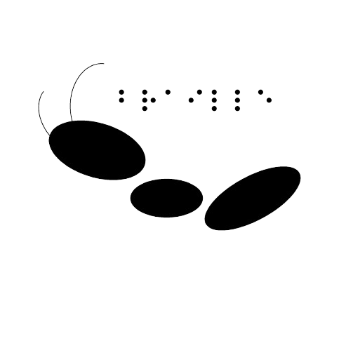

### - pip install braillebaseviet
### We are truly honored to take part in the ongoing story of Vietnamese Braille.

# Viet
"Thư viện được phát triển để xử lý chữ nổi Braille đơn giản và phức tạp năm 2026"

```python
from braille import *

bb = bbv()
print(bb.output_braille_txt("Thư viện được phát triển để xử lý chữ nổi Braille đơn giản và phức tạp năm 2026"))
```
Output: ⠠⠞⠓⠳⠀⠧⠊⠣⠝⠀⠮⠳⠪⠉⠀⠏⠓⠁⠞⠀⠞⠗⠊⠣⠝⠀⠮⠣⠀⠭⠳⠀⠇⠽⠀⠉⠓⠳⠀⠝⠹⠊⠀⠠⠃⠗⠁⠊⠇⠇⠑⠀⠮⠪⠝⠀⠛⠊⠁⠝⠀⠧⠁⠀⠏⠓⠳⠉⠀⠞⠁⠏⠀⠝⠜⠍⠀⠼⠃⠚⠃⠋

# Announcement
- This package is part of an ecosystem called Braille Base. This name does not represent a company or business; it is an independent initiative aimed at providing registered braille tables for all of humanity.

- We constantly need help to register, update, and validate braille tables. There is still no official contact channel, but you can find new information on the blog braillebase.blogspot.com or brailletable.blogspot.com.

## Pre-registered Letters and Characters

- a, á, à, ả, ã, ạ
- ă, ắ, ằ, ẳ, ẵ, ặ
- â, ấ, ầ, ẩ, ẫ, ậ
- b
- c
- d
- đ
- e, é, è, ẻ, ẽ, ẹ
- ê, ế, ề, ể, ễ, ệ
- g
- h
- i, í, ì, ỉ, ĩ, ị
- k
- l
- m
- n
- o, ó, ò, ỏ, õ, ọ
- ô, ố, ồ, ổ, ỗ, ộ
- ơ, ớ, ờ, ở, ỡ, ợ
- p
- q
- r
- s
- t
- u, ú, ù, ủ, ũ, ụ
- ư, ứ, ừ, ử, ữ, ự
- v
- x
- y, ý, ỳ, ỷ, ỹ, ỵ

- f, j, w, z

- A, Á, À, Ả, Ã, Ạ
- Ă, Ắ, Ằ, Ẳ, Ẵ, Ặ
- Â, Ấ, Ầ, Ẩ, Ẫ, Ậ
- B
- C
- D
- Đ
- E, É, È, Ẻ, Ẽ, Ẹ
- Ê, Ế, Ề, Ể, Ễ, Ệ
- G
- H
- I, Í, Ì, Ỉ, Ĩ, Ị
- K
- L
- M
- N
- O, Ó, Ò, Ỏ, Õ, Ọ
- Ô, Ố, Ồ, Ổ, Ỗ, Ộ
- Ơ, Ớ, Ờ, Ở, Ỡ, Ợ
- P
- Q
- R
- S
- T
- U, Ú, Ù, Ủ, Ũ, Ụ
- Ư, Ứ, Ừ, Ử, Ữ, Ự
- V
- X
- Y, Ý, Ỳ, Ỷ, Ỹ, Ỵ
- F,J,W,Z

- ⠼, 1, 2, 3, 4, 5, 6, 7, 8, 9, 0;

- ., ,, ;, :, !, ?, ';

- ", “, ”, ‘, ’, (, ), /, \ , [, ], ,{ ,} ,< ,> #; 

- +, −, ×, *, ÷, %, =; 

- $, ¢, ¥, €, £, ₣, ₦; 

- →, ↓, ←, ↑, ©, ®, ™, ♀, ♂, §, @, &, [@], [‘], [´], [*], [—], [-];

## Special: Greek Number
- [Α] ,[Β] ,[Γ] ,[Δ] ,[Ε] ,[Ζ] ,[Η] ,[Θ] ,[Ι] ,[Κ] ,[Λ] ,[Μ] ,[Ν] ,[Ξ] ,[Ο] ,[Π] ,[Ρ] ,[Σ] ,[Τ] ,[Υ] ,[Φ] ,[Χ] ,[Ψ] ,[Ω];
- [α] ,[β] ,[γ] ,[δ] ,[ε] ,[ζ] ,[η] ,[θ] ,[ι] ,[κ] ,[λ] ,[μ] ,[ν] ,[ξ] ,[ο] ,[π] ,[ρ] ,[σ] ,[τ] ,[υ] ,[φ] ,[χ] ,[ψ] ,[ω] ,[ς];

# BrailleBaseViet Overview
## BrailleBaseViet is a project designed to map the unique characteristics of the Vietnamese language and translate them into Braille.

<p>Although Vietnamese Braille incorporates elements of the UEB (Unified English Braille) standard, it also includes several distinctive features, drawing on European Braille systems as well as adaptations specific to the Vietnamese language itself. This combination of standards and linguistic features made the project an especially interesting and valuable technical challenge, contributing significantly to the development and refinement of our core conversion engine.<br>
<br>
We are very pleased to contribute to the development of educational tools that promote accessibility in Vietnam. Beyond being a country known for its welcoming people and distinctive cuisine, Vietnam also offered relatively favorable conditions for finding documents that describe the rules and conventions of Vietnamese Braille.
<br>
However, as in many countries around the world, some of these materials are available only as digitized photocopies. While these documents can be viewed digitally, their format often makes the content difficult for blind people to access, especially when no accessible text version is available for screen readers to process. This experience reinforced the importance of developing tools that not only facilitate Braille conversion but also help expand access to information and knowledge.<br>
<br>
We would like to thank you in advance for your interest in our tool. We would be delighted to have the opportunity to present it in person and share more about the project. We also hope to receive an invitation to visit Vietnam, learn more about its culture, and, of course, enjoy its famous and delicious Vietnamese coffee.<br></p>

  
